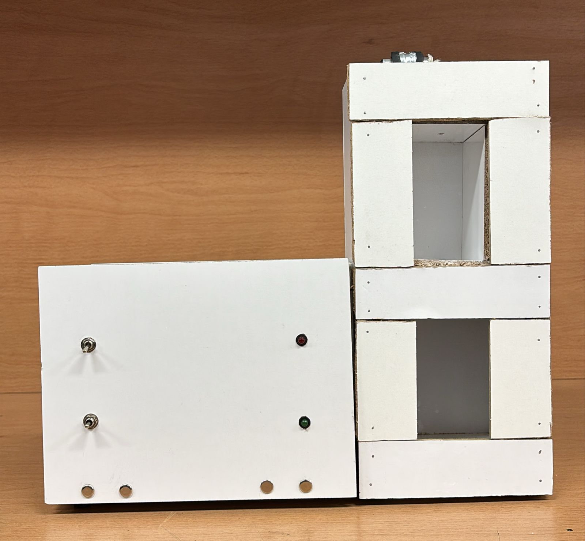
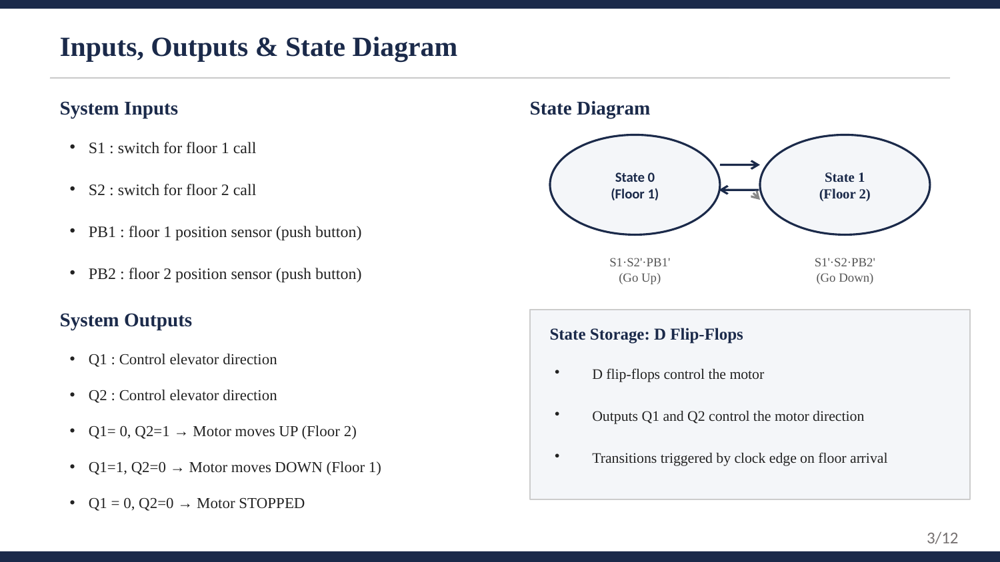
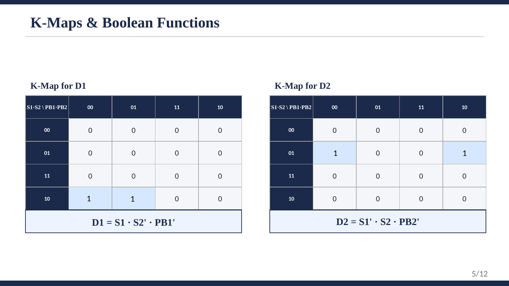
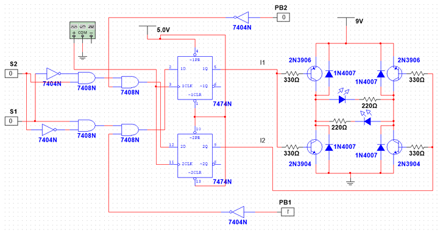
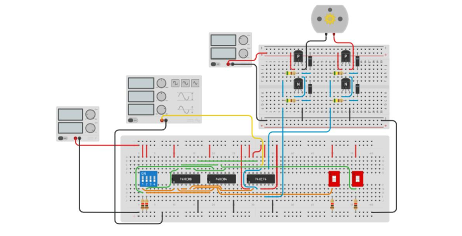

# 🛗 Two-Floor Elevator: Digital Logic Control System

**A working elevator controller built entirely from logic gates and D flip-flops, with no microcontroller.**

Floor-call switches and position sensors feed minimized Boolean logic. D flip-flops store the motor command, and a transistor H-bridge drives a DC motor up or down. It was designed with truth tables and K-maps, simulated, tested, and built as a physical model.



**▶️ [Run the live circuit simulation on Tinkercad](https://www.tinkercad.com/things/kPTsNF28y8F)**

---

## 📌 At a Glance

| | |
|---|---|
| **Course** | CCE 220L: Digital Systems Lab, American University of Science & Technology (AUST) |
| **Date** | Spring 2026 |
| **Team** | 4 students |
| **My role** | Circuit simulation, testing, technical report, and poster |
| **Tools** | Multisim, Tinkercad Circuits, 7404 (NOT), 7408 (AND), 7474 (D flip-flop), 2N3904/2N3906 H-bridge |
| **Status** | ✅ Simulated · ✅ Tested on breadboard · ✅ Built as a physical model |

---

## 🎯 Problem & Goal

An elevator has to answer a simple question safely: **which way should the motor turn, and when should it stop?**

This project solves that with pure digital logic, following the full design method:

**specification → truth table → K-map minimization → Boolean equations → gate-level circuit → simulation → hardware**

---

## 🧩 Inputs, Outputs & States



| Signal | Type | Meaning |
|---|---|---|
| **S1** | Input (switch) | Call to Floor 1 |
| **S2** | Input (switch) | Call to Floor 2 |
| **PB1** | Input (push button) | Position sensor: cabin is at Floor 1 |
| **PB2** | Input (push button) | Position sensor: cabin is at Floor 2 |
| **Q1, Q2** | Outputs (D flip-flops) | Motor direction command |

| Q1 | Q2 | Motor |
|---|---|---|
| 0 | 0 | ⏹️ Stopped |
| 0 | 1 | ⬆️ Up, toward Floor 2 |
| 1 | 0 | ⬇️ Down, toward Floor 1 |
| 1 | 1 | ⏹️ Stopped (invalid, never produced) |

---

## 🧮 Logic Design

### Truth Table

All 16 input combinations were analyzed:


### K-Map Minimization



The K-maps reduce the logic to just **two 3-input AND terms**:

```
D1 = S1 · S2' · PB1'     → go DOWN: Floor 1 is called, Floor 2 is not, and the cabin is not at Floor 1 yet
D2 = S1' · S2 · PB2'     → go UP:   Floor 2 is called, Floor 1 is not, and the cabin is not at Floor 2 yet
```

**Built-in safety:**
- The motor **stops automatically** when the cabin reaches the requested floor (PB1 or PB2 is pressed)
- If **both floors are called at once**, both outputs are 0, so the motor can never be driven in both directions

---

## ⚡ Circuit



| Stage | Components | Function |
|---|---|---|
| Input logic | 7404 inverters + 7408 AND gates | Compute D1 and D2 from the K-map equations |
| State storage | 7474 dual D flip-flop | Holds the motor command (Q1, Q2) |
| Motor driver | H-bridge: 2N3906 (PNP) + 2N3904 (NPN), 330 Ω base resistors | Reverses motor polarity for up/down |
| Protection | 1N4007 flyback diodes | Protect transistors from motor voltage spikes |
| Indicators | LEDs with 220 Ω resistors | Show motor direction |
| Power | 5 V logic supply, 9 V motor supply | Separate logic and motor power |

### Breadboard Simulation (Tinkercad)



▶️ **[Open and run this circuit in your browser](https://www.tinkercad.com/things/kPTsNF28y8F)**: flip the floor-call switches and press the floor sensors to watch the motor change direction and stop.

---

## ✅ Results

- ✅ All input combinations were **tested and produced the correct outputs**
- ✅ The elevator moves **up** when Floor 2 is called and **down** when Floor 1 is called
- ✅ The motor **stops** when the cabin reaches the target floor
- ✅ Conflicting calls (both floors) safely result in **no movement**
- ✅ Implemented as a **working breadboard prototype** inside a physical elevator model

<!-- 🎥 ADD A VIDEO / GIF OF THE ELEVATOR MOVING HERE

-->

---

## 🧠 What I Learned

- Applying the **complete digital design flow**, from a real-world problem to a working circuit
- Using **K-maps** to cut the logic down to a minimal number of gates
- Combining **combinational logic** (decisions) with **sequential logic** (D flip-flops for memory)
- Driving a DC motor in **both directions** with a transistor **H-bridge**
- **Simulating and testing** a design systematically before building hardware

---

## 🚀 Future Improvements

- Extend to **3+ floors** using more flip-flops and a state machine
- Add **floor indicator displays** (7-segment)
- Add **automatic doors**, an **alarm**, and an **emergency stop**
- Replace push-button sensors with **limit switches or IR sensors**
- Implement the same logic on an **FPGA** (Verilog) or a microcontroller and compare

---

## 📁 Repository Contents

| File | What it is |
|---|---|
| `Elevator_Final_Report.pdf` | Full technical report |
| `Elevator_Presentation.pdf` | Project presentation |
| `physical-model.jpg` | Photo of the built elevator model |
| `circuit-diagram.png` | Multisim circuit diagram |
| `breadboard-layout.png` | Breadboard wiring layout |
| `truth-table.png`, `kmaps.png`, `inputs-outputs-state-diagram.png` | Logic design |

📄 **[Read the full report (PDF)](Elevator_Final_Report.pdf)** · 📊 **[View the presentation (PDF)](Elevator_Presentation.pdf)**

---

## 👥 Team

Maya Shaib · Lama El Sayed · **Shaza Hamzeh** · Zahraa Raya

**Advisor:** Mr. Anthony Alam

Department of Mechatronics / Computer & Communications Engineering, AUST
